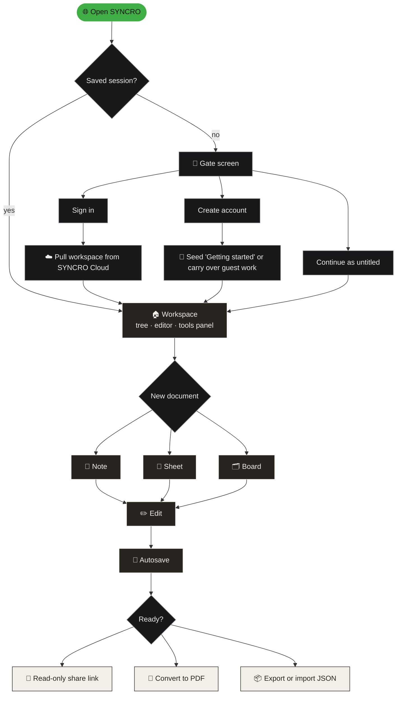
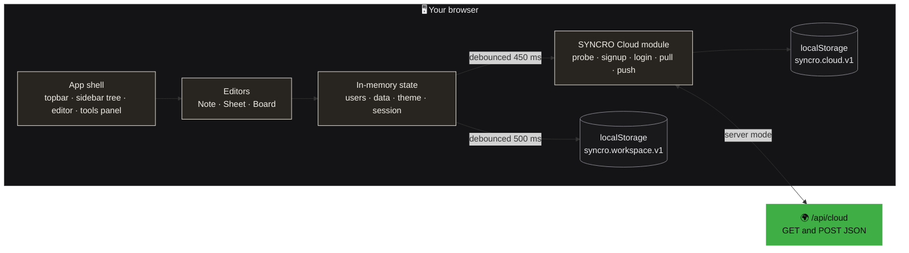
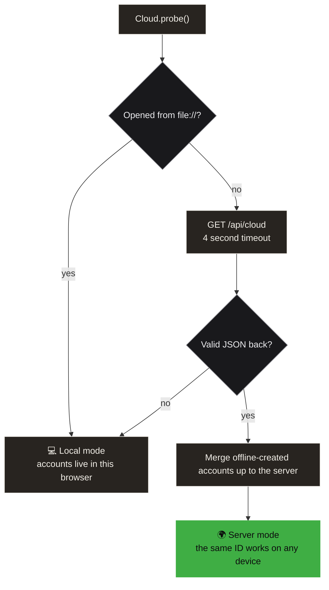
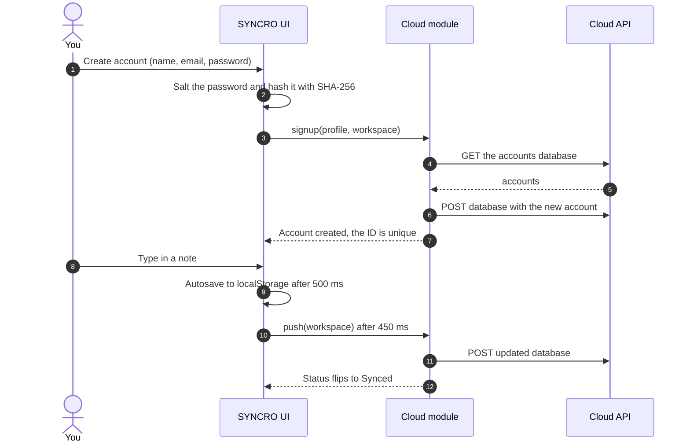
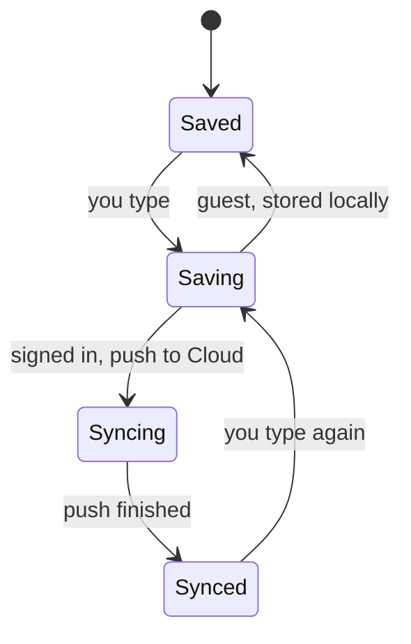
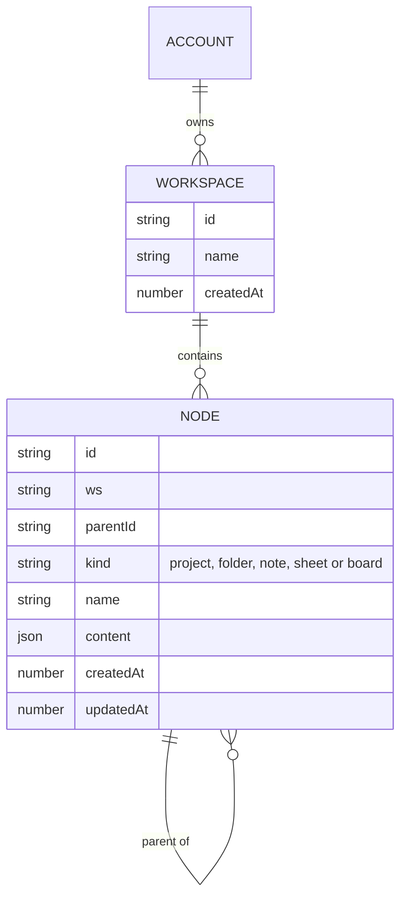

<div align="center">

  


  
  
  

<br><br>
<br>

<a href="https://github.com/UNFOTABLE01/syncro/stargazers"></a>
<a href="https://github.com/UNFOTABLE01/syncro/network/members"></a>
<a href="https://github.com/UNFOTABLE01/syncro/issues"></a>
<a href="https://github.com/UNFOTABLE01/syncro/commits/main"></a>


<br><br>

<a href="#-tour">Tour</a> &nbsp;|&nbsp;
<a href="#-features">Features</a> &nbsp;|&nbsp;
<a href="#-how-it-flows">Flow</a> &nbsp;|&nbsp;
<a href="#-under-the-hood">Under the hood</a> &nbsp;|&nbsp;
<a href="#-quick-start">Quick start</a> &nbsp;|&nbsp;
<a href="#-cheat-sheet">Cheat sheet</a> &nbsp;|&nbsp;
<a href="#-roadmap">Roadmap</a>

</div>

<br>


<br>

## 👋 Meet SYNCRO

**SYNCRO is a calm productivity workspace that fits in one browser tab.**

Write a note. Crunch numbers with real formulas. Drag cards across a kanban board. Then share it as a read-only link or print it to PDF. There is nothing to install, nothing to build, and nothing to `npm install`. Open the file and start working.

> We are a team of designers and developers with one mission: build a website that makes life easier. SYNCRO blends smart features, intuitive design and useful tools into one seamless place, so everyday complexity turns into simplicity.


<br>

## 📸 Tour

Every screen has the same three-part layout: a **document tree** on the left, the **editor** in the middle, and a **tools panel** on the right that adapts to whatever you are editing.

> Preview images show the sample workspace you get on first launch.

### 📝 Notes


- Headings, bold, italic, underline, strikethrough, bullet and numbered lists
- Real **checklists** you can tick off, plus quotes, code blocks, dividers and links
- Select any text and a **floating format bar** appears right where you are working
- Mix typefaces freely on one page, with text colours and highlights from the side panel

### 🧮 Sheets


- A proper grid with sticky headers, a **formula bar** and a highlighted active cell
- Formulas such as `=SUM`, `=AVG`, `=MIN`, `=MAX`, `=ROUND` and plain arithmetic like `=B2-C2`
- Numbers right-align, formulas stand out, and errors show up right in the cell

### 🗂 Boards


- Lists and cards you can **drag and drop**, with the target list lighting up as you hover
- Click a card to edit it in place, tag it with a colour dot, delete it with one click
- Rename lists inline and add new ones with a single tap

<br>


<br>

## ⚡ Features

<table>
  <tr>
    <td width="33%" valign="top"><b>🔐 Accounts or guest</b><br>Sign in, create an account, or hit <b>Continue as untitled</b> to explore. Guest work carries over when you sign up.</td>
    <td width="33%" valign="top"><b>☁️ SYNCRO Cloud</b><br>One ID, any device. It picks its transport automatically: a real server when one is there, browser storage when not.</td>
    <td width="33%" valign="top"><b>💾 Autosave</b><br>Everything saves as you type. A live status in the top bar flips between <i>Saving</i>, <i>Syncing</i> and <i>Synced</i>.</td>
  </tr>
  <tr>
    <td valign="top"><b>🗃 Workspaces</b><br>Several workspaces, each with projects and folders in a collapsible tree, plus instant document search.</td>
    <td valign="top"><b>🔗 Read-only sharing</b><br>Turn any document into a link. Viewers see a clean read-only page, nothing editable.</td>
    <td valign="top"><b>📄 Export and convert</b><br>Print-ready <b>PDF</b> output, plus <b>JSON</b> export and import for backups and moving between machines.</td>
  </tr>
  <tr>
    <td valign="top"><b>🌗 Dark and light</b><br>A monochrome ink design in both themes, switched with one button and remembered.</td>
    <td valign="top"><b>📱 Responsive</b><br>The side panels become slide-over drawers on tablets and phones, and the layout keeps working.</td>
    <td valign="top"><b>♿ Considerate</b><br>Visible keyboard focus, reduced-motion support and a dedicated print stylesheet.</td>
  </tr>
</table>

<br>

## 🧭 How it flows

From first click to shared link, here is the whole journey through the app:



<br>

## 🔬 Under the hood

SYNCRO is deliberately small: one HTML file, no build chain, plain browser APIs. These diagrams show how the pieces fit.

<details open>
<summary><b>🏗 Architecture</b>: what lives where</summary>

<br>



</details>

<details>
<summary><b>☁️ Cloud transport</b>: how SYNCRO decides where accounts live</summary>

<br>

On startup the Cloud module probes for a server. If one answers, accounts are shared across every device. If not, SYNCRO keeps working in local mode, and any accounts created offline are merged up to the server the moment it appears.



</details>

<details>
<summary><b>🔁 Sign-up and sync</b>: what happens when you create an account and type</summary>

<br>



</details>

<details>
<summary><b>💾 Save status</b>: the little indicator in the top bar</summary>

<br>



</details>

<details>
<summary><b>🧱 Data model</b>: how a workspace is stored</summary>

<br>

Every document is a **node**. Projects and folders are nodes too, which is how the sidebar tree nests to any depth.



</details>

<details>
<summary><b>🔌 Cloud endpoint contract</b>: for anyone adding a backend</summary>

<br>

The repo ships the front end only. If your host serves `/api/cloud`, SYNCRO switches to server mode by itself. The contract is one URL with two verbs:

| Verb | Body | Returns |
|------|------|---------|
| `GET /api/cloud` | none | `200` with the accounts database as JSON |
| `POST /api/cloud` | the full accounts database as JSON | any `2xx` on success |

```jsonc
{
  "v": 1,
  "accounts": {
    "you@example.com": {
      "profile": { "name": "…", "email": "…", "salt": "…", "hash": "…", "color": ["#…", "#…"], "createdAt": 0 },
      "data":    { "workspaces": [], "nodes": {}, "lastWs": null, "lastDoc": null, "expanded": {} },
      "updatedAt": 0
    }
  }
}
```

</details>

<br>


<br>

## 🚀 Quick start

**The 10-second way.** Clone it and double-click `index.html`.

```bash
git clone https://github.com/UNFOTABLE01/syncro.git
cd syncro
open index.html          # macOS   (Windows: start index.html, Linux: xdg-open index.html)
```

**The proper way.** Serve it over HTTP so the browser treats it like a real site:

```bash
python3 -m http.server 8080      # then visit http://localhost:8080
# or
npx serve .
```

**Put it online.** Any static host works. On GitHub Pages, go to *Settings → Pages*, choose **Deploy from a branch**, pick `main` and `/ (root)`, and your site appears at `https://<your-username>.github.io/syncro/`.

> **Where does my data live?** With no `/api/cloud` endpoint, SYNCRO runs in local mode and everything, accounts included, is stored in your browser's `localStorage`. Clearing site data clears your workspace, so use **Export data** for backups.

<br>

## 🧮 Cheat sheet

### Sheet formulas

| Formula | What it does | Example |
|---------|--------------|---------|
| `=SUM(range)` | Adds a range | `=SUM(B2:B5)` |
| `=AVG(range)` | Averages a range | `=AVG(C2:C5)` |
| `=MIN(range)` | Smallest value | `=MIN(B2:B5)` |
| `=MAX(range)` | Largest value | `=MAX(B2:B5)` |
| `=ROUND(x, digits)` | Rounds a result | `=ROUND((B7-C7)/B7*100,1)` |
| `=A1-B1` | Arithmetic with cell references | `=B2-C2` |

### Keys and gestures

| Do this | To get this |
|---------|-------------|
| `Ctrl` / `Cmd` + `B`, `I`, `U` | Bold, italic, underline |
| Select text | The floating format bar |
| Drag a card | Move it between board lists |
| `Enter` in a name dialog | Confirm |

<br>

## 🎨 Design language

SYNCRO looks the way it does on purpose: **ink on paper.** The whole interface is black, white and grey with tight 2 to 4 px corners, so the one green dot in the logo is the only colour on screen.


<br>

## 📁 Project structure

```text
syncro/
├── index.html      # the complete app: markup, styles and script in one file
├── app.js          # application script
├── style.css       # stylesheet
├── README.md       # you are here
└── assets/         # README artwork: banner, previews, palette, divider
```

<br>

## 🧱 Tech stack

| Layer | Choice | Notes |
|-------|--------|-------|
| Markup | HTML5 | One document, semantic regions for topbar, sidebar, editor and tools |
| Styling | CSS3 | Custom properties for theming, CSS Grid for the app shell, a print stylesheet |
| Logic | Vanilla JavaScript | No framework, no bundler, no transpiler |
| Rich text | `contenteditable` | The note editor, with a floating selection toolbar |
| Passwords | Web Crypto API | Salted SHA-256 |
| Storage | `localStorage` | Workspace and local cloud cache |
| Sync | Fetch API | Talks to `/api/cloud` when it exists |
| Type | Google Fonts | Inter, Poppins, Merriweather, Playfair Display, JetBrains Mono, Caveat, Stardos Stencil |

<br>

## 🔐 Security note

> [!WARNING]
> SYNCRO is built for demos, side projects and personal notes. As written, the browser verifies passwords itself, and the `/api/cloud` contract hands the whole accounts database to every client. **Do not store sensitive or private data in it** until you add real server-side authentication.

<br>

## 🔮 Roadmap

What has shipped, and what could come next.

- [x] Notes, sheets and boards in one workspace
- [x] Accounts, guest mode and SYNCRO Cloud
- [x] Read-only share links, PDF and JSON export
- [x] Dark and light themes, responsive layout
- [ ] Server-side password hashing (Argon2 or bcrypt) and per-user sessions
- [ ] Real-time collaboration on shared documents
- [ ] More sheet functions (`COUNT`, `IF`) and CSV import and export
- [ ] Due dates, labels and checklists on board cards
- [ ] Installable offline app (PWA)
- [ ] Markdown import and export for notes

<br>

## 🤝 Contributing

Contributions of every size are welcome.

1. **Fork** the repo and create a branch: `git checkout -b feat/my-idea`
2. Open `index.html` in your browser and make your change
3. Check it in **both themes** and at a **narrow width**
4. Commit with a clear message and open a **pull request**

A few house rules keep SYNCRO feeling like SYNCRO: stay dependency-free, use the existing colour variables instead of hard-coded colours, and keep corners tight.

<br>

## 👥 The team

**A team of the best, building the best.** Designers and developers, one mission.

<a href="https://github.com/UNFOTABLE01/syncro/graphs/contributors">
  
</a>

<br><br>


<div align="center">

<br>

**Notes, sheets and boards, in sync with your flow.**

<sub>If SYNCRO makes your day a little simpler, a ⭐ on the repo means a lot.</sub>

<br>

<a href="#readme">Back to top</a>

</div>
